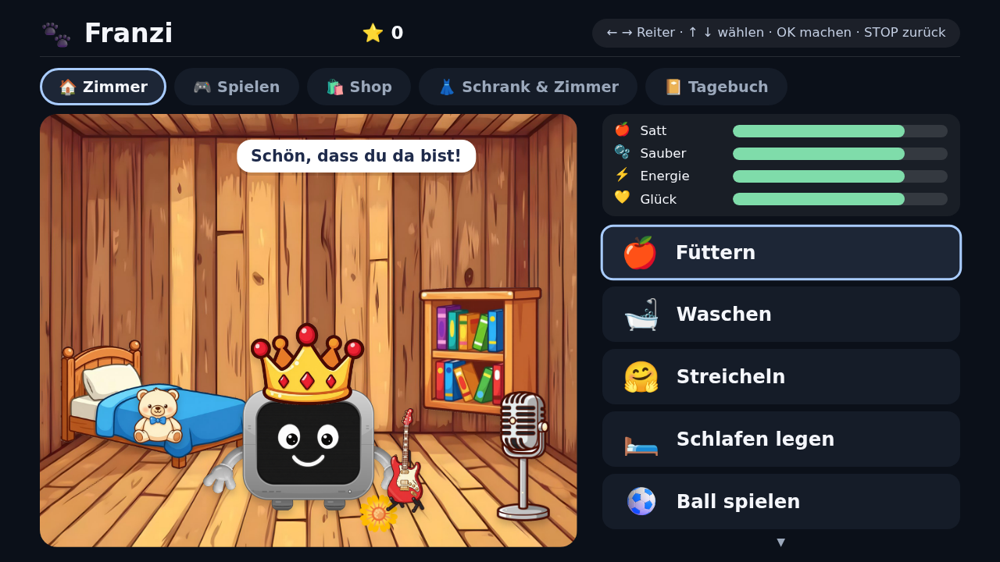
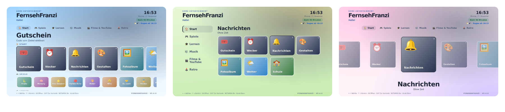
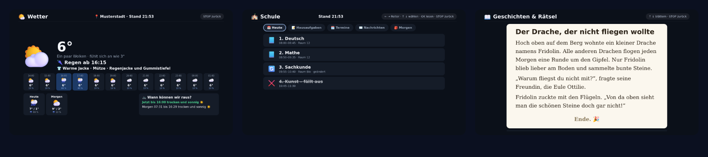
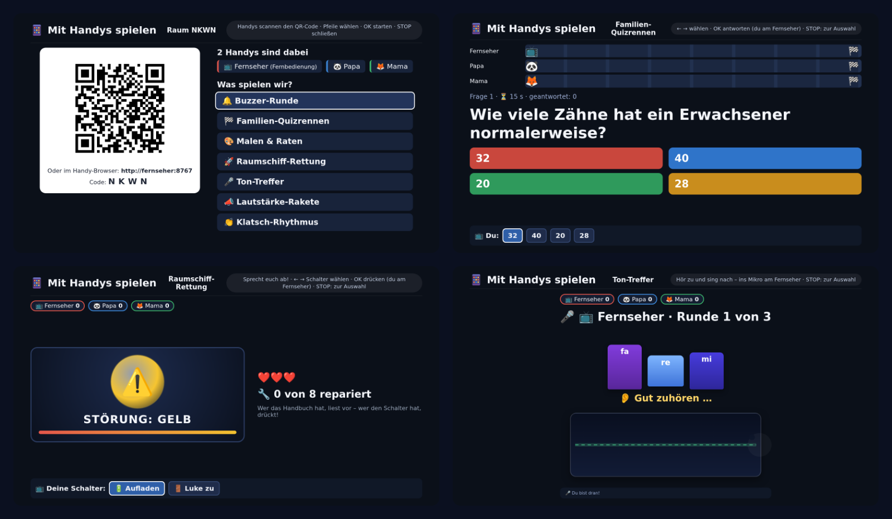
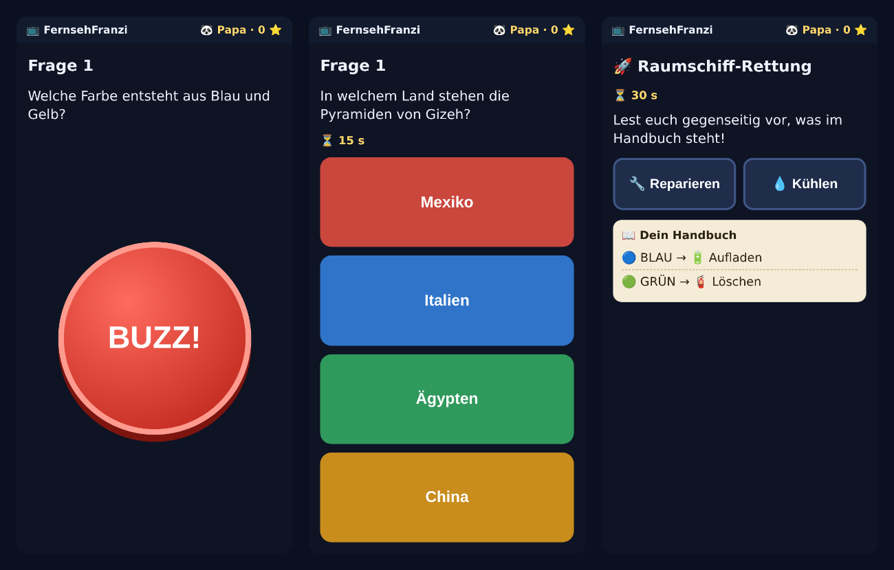
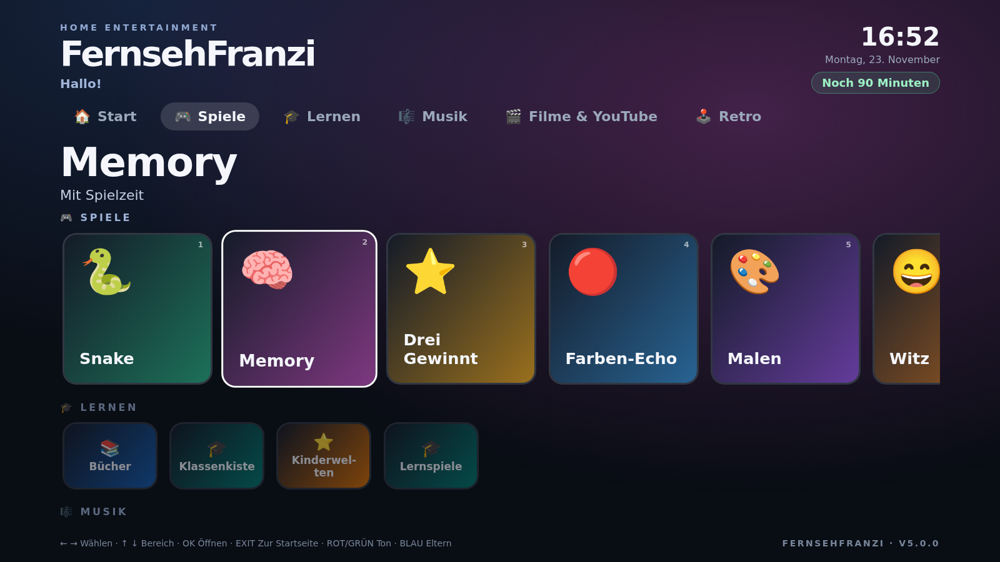
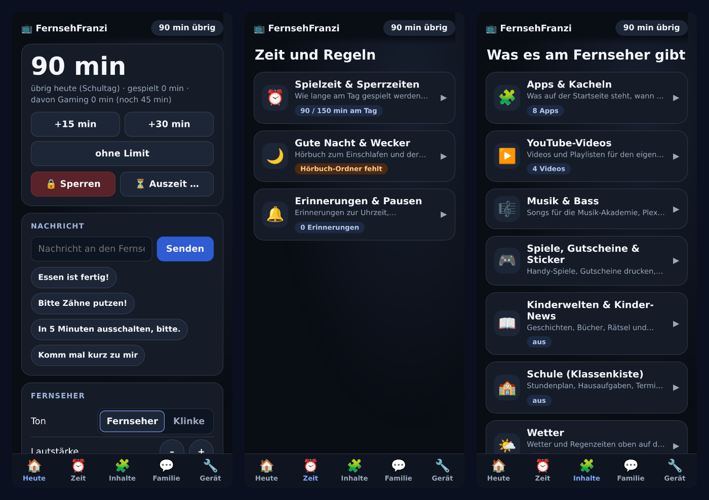

# 📺 FernsehFranzi

**Ein Raspberry Pi am Fernseher wird zum Smart-TV für Kinder.** Eine schnelle Startseite für Filme, Bücher, Hörbücher,
Retro-Spiele und Lern-Apps, ein eigenes Spielzimmer, **Franzi – ein Haustier zum Pflegen**, ein Zeitkonto mit den Regeln der Eltern und ein Elternbereich am
Fernseher und auf dem Handy. Bedient wird alles mit der normalen TV-Fernbedienung, einem Controller oder einer Tastatur.

[](https://github.com/bussdee/fernsehfranzi/releases/latest)
[](LICENSE)


**[⬇️ Download](https://github.com/bussdee/fernsehfranzi/releases/latest)** ·
**[📕 Handbuch (PDF)](web/handbuch.pdf)** ·
**[🗒️ Kurzanleitung zum Ausdrucken (PDF)](web/kurzanleitung.pdf)** ·
**[📖 Anleitung für Eltern (PDF)](web/anleitung.pdf)** ·
**[🧒 Anleitung für Kinder (PDF)](web/kinder-anleitung.pdf)** ·
**[🧰 Installation](docs/INSTALLATION.md)** ·
**[🛠️ Entwickler-Dokumentation](docs/ENTWICKLUNG.md)** ·
**[📝 Änderungen](CHANGELOG.md)**


## Was FernsehFranzi kann

| | |
|---|---|
| 🐾 **Franzi (neu in v8)** | Ein kleiner Fernseher mit Armen und Antennen als Haustier: füttern, waschen, streicheln, schlafen legen, spielen. Eigene Räume (Kinderzimmer bis Bad), gezeichnete Gegenstände aus dem Sterne-Shop frei platzieren und anfassen (Mikrofon, Gitarre, Musikbox …), Franzi tanzt und spielt Gitarre, schickt Postkarten von Abenteuerreisen, wird mit Level 10 golden und wächst. Sie spricht auf der Startseite (Witze, Tipps, eigene Sätze der Eltern), zeigt passende Gefühle und taucht in Musik, Filmen, Wetter und Spielen auf. |
| 🏠 **Startseite** | Große Kacheln in Bereichen (Start, Spiele, Lernen, Musik, Filme & YouTube, Retro). Uhr, Begrüßung und die Restzeit („Noch 90 Minuten“) immer im Blick. |
| 🎬 **Filme & YouTube** | Plex und eigene Video-Ordner aus dem Heimnetz im Stil einer Streaming-App (Weiterschauen, Serien mit Staffeln, Meine Liste, nächste Folge); Musik wie in einer Musik-App; Archiv-Ordner als Belohnung. YouTube nur mit den Videos und Playlisten, die die Eltern ausgesucht haben, in einem eigenen Player ohne Vorschläge. |
| 📚 **Bücher & Hörbücher** | Kavita für Bücher und Comics, Hörbücher aus einem freigegebenen Ordner, „Gute Nacht“ mit Einschlaf-Timer. |
| 🕹️ **Retro-Spiele** | RetroPie mit C64, Amiga, N64 und mehr. „Zuletzt gespielt“ direkt auf der Startseite, Spielbilder per Knopfdruck. Während eines Spiels ist der Browser ganz aus, damit der Pi genug Speicher hat. |
| 🎮 **Spielzimmer** | Eigene kleine Spiele: Snake, Memory (auch mit selbst gemalten Bildern), Drei gewinnt, Farben-Echo, Malen, Spiele zu zweit, Sticker-Album. |
| 🎸 **Musik & Lernen** | Musik-Akademie, Bass-Ecke mit Mikrofon (Stimmgerät, Nachspielen, Tagebuch), Lernspiele. Lernzeit kann Spielzeit verdienen. |
| ⏱️ **Zeitkonto** | Bildschirmzeit und Gaming-Zeit für Schultage und Wochenende, „Erst-dann“ (Spiele erst nach Lernen oder Mein Tag), Limits je App, Sperrzeiten, Ferien des Bundeslandes per Knopf, Gutschein-Codes zum Ausdrucken. |
| 🎨 **Farben** | Zehn klare Farben (dunkel und hell), abends wird hell automatisch dunkel; Startseite „Zuhause“ mit Lieblingen, „Weiter“ und Bereichen. |
| 🌤️ **Wetter** | Wetter und Regenzeiten oben auf der Startseite und als eigene Seite: „Wann können wir raus?“ (Open-Meteo, ohne Konto). |
| 🏫 **Schule** | Stundenplan, Hausaufgaben, Termine und Klassennachrichten aus der Klassenkiste, nur lesen, mit Meldung bei Neuem und Morgen-Check. |
| 📖 **Geschichten & News** | Geschichten, Bücher und Rätsel der Kinderwelten (Familienfabrik) zum Selberlesen, Kinder-News nur aus freigeschalteten Quellen. |
| 📱 **Mit Handys spielen** | Der Fernseher zeigt einen QR-Code, jeder spielt am eigenen Handy mit: Buzzer-Runde, Familien-Quizrennen, Malen & Raten, Raumschiff-Rettung (gemeinsam), dazu die Mikro-Spiele Ton-Treffer, Lautstärke-Rakete und Klatsch-Rhythmus. Das Kind spielt mit der Fernbedienung. |
| 🔔 **Familie** | Nachrichten, Fotos, Sprachnachrichten und Videos am Fernseher, auch über Telegram – mit Absender, „An wen?“ und Grenzen je Kontakt (z. B. für die beste Freundin). Die Eltern lesen mit, steuern per Befehl (`/zeit 30`, `/foto` …) und bekommen Meldungen und einen Tagesbericht. Wecker. |
| 🧱 **Eigene Spiele** | Neben Snake, Memory & Co. jetzt auch Steine-Brecher (Level als Bilder aus Steinen), ein 3D-Labyrinth (Feld für Feld mit der Fernbedienung) und das Jump'n'Run „Franzi hüpft“. |
| 🎤 **Stimm-Spiele** | Möwenflug (je höher der Ton, desto höher die Möwe), „Pst – der Drache schläft“, Klatsch-Läufer und Ton-Kanone – mit dem USB-Mikro, ohne Mikro mit den Pfeilen. |
| 📋 **Mein Tag** | Morgen- und Abend-Listen der Eltern, die das Kind mit der Fernbedienung abhakt – mit Zeit-Scheibe („noch 10 Minuten“), Zahnputz-Timer mit Musik; die Liste öffnet sich zur Uhrzeit von selbst (auch nach dem Wecker), erinnert alle 10 Minuten bis geschafft und meldet den Eltern, wenn nicht; Ranzen-Check aus dem Stundenplan, Aufgaben mit Sternen (die Eltern bestätigen, auch per Telegram); mit Sternen steigt Franzi im Level (neue Räume, goldene Franzi); Vorlese-Zeit mit Lesepass (das Mikro misst nur, nimmt nichts auf). |
| 🎤 **Karaoke** | Die Lieder der Klassenkiste mit großem Text im Takt, Musik und Mikro-Sternen. |
| 🖼️ **Fotoalbum** | Das Kind wählt Bilder aus einem Ordner der Eltern, seinem Album und seinen Zeichnungen und zeigt sie als Bildschirmschoner. |
| 🎧 **Ton** | HDMI oder Klinke per Farbtaste; ein Bluetooth-Kopfhörer bekommt den Ton automatisch, sobald er verbunden ist. |
| 🔒 **Kindersicher** | Kiosk ohne Ausweg (kein Desktop, kein Terminal), Whitelist für Internetseiten (auch für Fritzbox oder Pi-hole), Eltern-PIN nur als gesalzener Hash. |

### Franzi, das Haustier



### Spielzimmer


### Farben

Das Kind wählt die Farbe – dunkel oder hell – und bis zu sechs Lieblinge. Die Eltern legen fest, welche Farben es gibt
und ab wann abends automatisch dunkel wird.



### Wetter, Schule und Geschichten

Wetter mit Regenzeiten und „Wann können wir raus?“, der Schultag aus der Klassenkiste und Geschichten zum Selberlesen –
jede Seite schalten die Eltern einzeln ein. Von außen wird nur gelesen.



### Mit Handys spielen

Die Eltern schalten die Handy-Spiele frei, dann scannt jeder den QR-Code am Fernseher. Der Zugang ist nur offen, solange
gespielt wird, und gespeichert wird nichts über die Mitspieler.





### Zuhause und Bereiche

„Zuhause“ zeigt die Lieblinge, „Weiter, wo du warst“ und die Bereiche; OK öffnet einen Bereich als Raster, STOP führt
zurück. EXIT auf der Fernbedienung führt von überall zurück zur Startseite.



### Eltern-Seite am Handy

Im Heimnetz mit PIN, aufgebaut wie eine App: unten die Reiter 🏠 Heute, ⏰ Regeln, 🧩 Apps, ⭐ Franzi, 🎨 Aussehen und
⚙️ Mehr, jeder Bereich klappt mit einem Tipp auf; am PC zweispaltig. Zeit gutschreiben oder sperren, eine Nachricht an den Fernseher schicken, Regeln und Apps
einstellen, die Statistik ansehen, ein Bild vom Fernseher abrufen (am Fernseher erscheint dann ein 📷), Bluetooth-Geräte
koppeln, eine Sicherung herunterladen. Dasselbe gibt es als Elternbereich direkt am Fernseher (BLAU auf der Fernbedienung).



## Bedienung

| Fernbedienung | Wirkung |
|---|---|
| ← → ↑ ↓, OK | Kachel wählen, Bereich wechseln, starten |
| 1 – 9 | Kachel direkt starten |
| EXIT | Von überall zurück zur Startseite (auch aus Retro-Spielen) |
| STOP | Zurück, Spiel schließen |
| ROT / GRÜN | Ton über den Fernseher (HDMI) / über die Klinke |
| BLAU | Elternbereich (PIN) |

Controller und Tastatur funktionieren genauso. Alle Tasten, auch für Retro-Spiele, stehen in den
[Anleitungen](web/anleitung.pdf).

## Hardware und System

- Raspberry Pi 3B+ (1 GB) mit Kühlkörper, besser mit Lüfter
- Raspberry Pi OS (Bookworm) mit labwc, Chromium und RetroPie
- Fernseher mit HDMI-CEC; optional Controller und Bluetooth-Tastatur
- Optional im Heimnetz: Plex, Kavita, FileBrowser, ein Telegram-Bot

> **Einrichten:** Die [Installationsanleitung](docs/INSTALLATION.md) führt von der leeren SD-Karte bis zum fertigen
> Kinder-Fernseher. Sie beschreibt den Weg, auf dem FernsehFranzi entstanden ist; auf einem ganz frischen Gerät ist sie
> noch nicht vollständig durchgespielt.

## Ausprobieren am PC

Die Startseite läuft auch ohne Raspberry Pi, mit Python 3 und einem Browser:

```bash
git clone https://github.com/bussdee/fernsehfranzi.git
cd fernsehfranzi
make v3-lokal
```

Dann `http://127.0.0.1:8765/` öffnen und mit Pfeilen, Enter, Ziffern und Esc bedienen.

## Aufbau

| Ordner | Inhalt |
|---|---|
| [`server/`](server/) | Das Gehirn: Startseite, Kiosk-API, Zeitkonto, Elternbereich (Python, nur Standardbibliothek) |
| [`web/`](web/) | Startseite, Spiele, Elternbereich, Eltern-Seite (JavaScript ohne Framework und ohne Build-Schritt) |
| [`kiosk/`](kiosk/) | Steuert Chromium über die DevTools-Pipe |
| [`eingabe/`](eingabe/) | Fernbedienung (CEC), Controller und Tastatur |
| [`system/`](system/), [`install/`](install/) | systemd-Units, Kiosk-Härtung, Installation und Rückweg |
| [`werkzeuge/`](werkzeuge/) | Ausliefern, Geräteprüfung, RetroPie-Erweiterung, Anleitungen und Bildschirmfotos erzeugen |
| [`tests/`](tests/) | Unittests und Oberflächentests mit Playwright |

Mehr dazu in der [Entwickler-Dokumentation](docs/ENTWICKLUNG.md): Grundsätze, Architektur, Schnittstellen,
Datenablage, Sicherheit, Tests, Ausliefern und die Lehren aus der Entwicklung.

## Entwickeln

```bash
make venv          # einmalig: Playwright und shellcheck in .venv
cp config/beispiel/einstellungen.js config/einstellungen.js   # persönliche Werte (nicht versioniert)
cp config/beispiel/pi.mk config/pi.mk                         # Zielgerät (nicht versioniert)
make check         # statische Prüfungen
make test          # alle Tests
make bildschirmfotos   # die Bilder in docs/bilder neu erzeugen
```

## Lizenz

[MIT](LICENSE). Die Emoji-Schrift in `web/fonts/` ist ein Ausschnitt aus Noto Color Emoji (SIL Open Font License 1.1,
siehe [Lizenztext](web/fonts/LIZENZ-Noto-Color-Emoji.txt)). Die 3D-Bilder in `web/icons/` stammen aus
[Fluent Emoji](https://github.com/microsoft/fluentui-emoji) von Microsoft (MIT, [Lizenztext](web/icons/LIZENZ-fluentui-emoji.txt)). Spielbilder lädt der Scraper zur Laufzeit aus den freien
[libretro-thumbnails](https://github.com/libretro-thumbnails); sie sind nicht Teil dieses Repositorys. ROMs,
Kickstart-Dateien und Filme liegen nicht bei.
