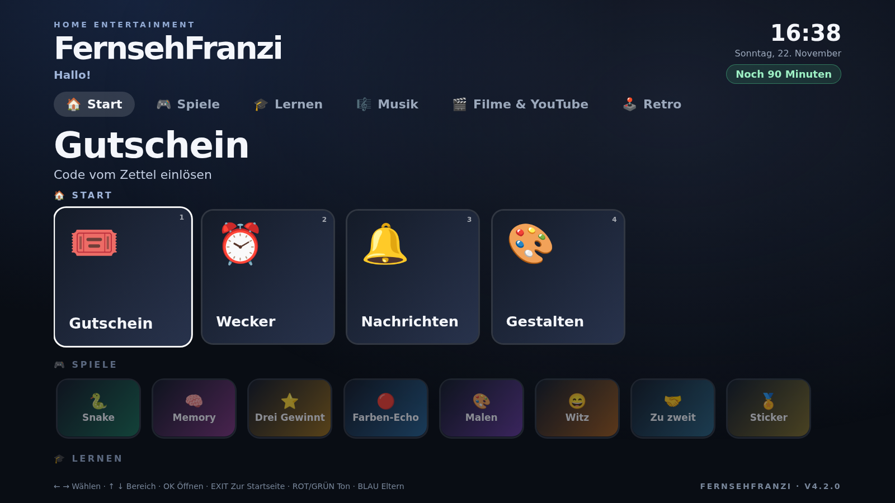
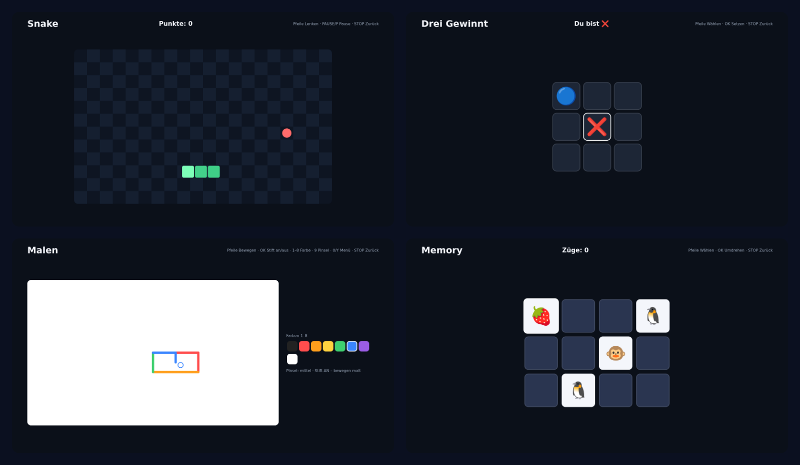

# 📺 FernsehFranzi

**Ein Raspberry Pi am Fernseher wird zum Smart-TV für Kinder.** Eine schnelle Startseite für Filme, Bücher, Hörbücher,
Retro-Spiele und Lern-Apps, ein eigenes Spielzimmer, ein Zeitkonto mit den Regeln der Eltern und ein Elternbereich am
Fernseher und auf dem Handy. Bedient wird alles mit der normalen TV-Fernbedienung, einem Controller oder einer Tastatur.

[](https://github.com/bussdee/fernsehfranzi/releases/latest)
[](LICENSE)


**[⬇️ Download](https://github.com/bussdee/fernsehfranzi/releases/latest)** ·
**[📖 Anleitung für Eltern (PDF)](web/anleitung.pdf)** ·
**[🧒 Anleitung für Kinder (PDF)](web/kinder-anleitung.pdf)** ·
**[🛠️ Entwickler-Dokumentation](docs/ENTWICKLUNG.md)** ·
**[📝 Änderungen](CHANGELOG.md)**



## Was FernsehFranzi kann

| | |
|---|---|
| 🏠 **Startseite** | Große Kacheln in Bereichen (Start, Spiele, Lernen, Musik, Filme & YouTube, Retro). Uhr, Begrüßung und die Restzeit („Noch 90 Minuten“) immer im Blick. |
| 🎬 **Filme & YouTube** | Plex und eigene Video-Ordner aus dem Heimnetz. YouTube nur mit den Videos und Playlisten, die die Eltern ausgesucht haben, in einem eigenen Player ohne Vorschläge. |
| 📚 **Bücher & Hörbücher** | Kavita für Bücher und Comics, Hörbücher aus einem freigegebenen Ordner, „Gute Nacht“ mit Einschlaf-Timer. |
| 🕹️ **Retro-Spiele** | RetroPie mit C64, Amiga, N64 und mehr. „Zuletzt gespielt“ direkt auf der Startseite, Spielbilder per Knopfdruck. Während eines Spiels ist der Browser ganz aus, damit der Pi genug Speicher hat. |
| 🎮 **Spielzimmer** | Eigene kleine Spiele: Snake, Memory (auch mit selbst gemalten Bildern), Drei gewinnt, Farben-Echo, Malen, Spiele zu zweit, Sticker-Album. |
| 🎸 **Musik & Lernen** | Musik-Akademie, Bass-Ecke mit Mikrofon (Stimmgerät, Nachspielen, Tagebuch), Lernspiele. Lernzeit kann Spielzeit verdienen. |
| ⏱️ **Zeitkonto** | Tages-Timer für Schultage und Wochenende, Limits je App, Sperrzeiten, Schlafenszeit, Gutschein-Codes zum Ausdrucken. |
| 🔔 **Familie** | Nachrichten und Erinnerungen mit Gong am Fernseher, auch über Telegram. Antworten mit fertigen Texten oder der Tastatur. Wecker. |
| 🔒 **Kindersicher** | Kiosk ohne Ausweg (kein Desktop, kein Terminal), Whitelist für Internetseiten (auch für Fritzbox oder Pi-hole), Eltern-PIN nur als gesalzener Hash. |

### Spielzimmer



### Bereiche statt Menüs

Mit ↑ ↓ wechselt man den Bereich, mit ← → die Kachel, OK startet. EXIT auf der Fernbedienung führt von überall zurück
zur Startseite.


### Eltern-Seite am Handy

Im Heimnetz mit PIN: Zeit gutschreiben oder sperren, eine Nachricht an den Fernseher schicken, Regeln und Apps
einstellen, die Statistik ansehen, ein Bild vom Fernseher abrufen (am Fernseher erscheint dann ein 📷), Bluetooth-Geräte
koppeln, eine Sicherung herunterladen. Dasselbe gibt es als Elternbereich direkt am Fernseher (BLAU auf der Fernbedienung).


## Bedienung

| Fernbedienung | Wirkung |
|---|---|
| ← → ↑ ↓, OK | Kachel wählen, Bereich wechseln, starten |
| 1 – 9 | Kachel direkt starten |
| EXIT | Von überall zurück zur Startseite (auch aus Retro-Spielen) |
| STOP | Zurück, Spiel schließen |
| ROT / GRÜN | Ton über den Fernseher (HDMI) / über die Klinke |
| BLAU | Elternbereich (PIN) |

Controller und Tastatur funktionieren genauso. Alle Tasten, auch für Retro-Spiele, stehen in den
[Anleitungen](web/anleitung.pdf).

## Hardware und System

- Raspberry Pi 3B+ (1 GB) mit Kühlkörper, besser mit Lüfter
- Raspberry Pi OS (Bookworm) mit labwc, Chromium und RetroPie
- Fernseher mit HDMI-CEC; optional Controller und Bluetooth-Tastatur
- Optional im Heimnetz: Plex, Kavita, FileBrowser, ein Telegram-Bot

> **Hinweis:** FernsehFranzi ist für genau dieses Gerät gebaut. Es gibt noch keine Schritt-für-Schritt-Installation für
> ein frisch aufgesetztes System. Wer es nachbauen möchte, findet Aufbau, Einrichtung und Ausliefern in der
> [Entwickler-Dokumentation](docs/ENTWICKLUNG.md).

## Ausprobieren am PC

Die Startseite läuft auch ohne Raspberry Pi, mit Python 3 und einem Browser:

```bash
git clone https://github.com/bussdee/fernsehfranzi.git
cd fernsehfranzi
make v3-lokal
```

Dann `http://127.0.0.1:8765/` öffnen und mit Pfeilen, Enter, Ziffern und Esc bedienen.

## Aufbau

| Ordner | Inhalt |
|---|---|
| [`server/`](server/) | Das Gehirn: Startseite, Kiosk-API, Zeitkonto, Elternbereich (Python, nur Standardbibliothek) |
| [`web/`](web/) | Startseite, Spiele, Elternbereich, Eltern-Seite (JavaScript ohne Framework und ohne Build-Schritt) |
| [`kiosk/`](kiosk/) | Steuert Chromium über die DevTools-Pipe |
| [`eingabe/`](eingabe/) | Fernbedienung (CEC), Controller und Tastatur |
| [`system/`](system/), [`install/`](install/) | systemd-Units, Kiosk-Härtung, Installation und Rückweg |
| [`werkzeuge/`](werkzeuge/) | Ausliefern, Geräteprüfung, RetroPie-Erweiterung, Anleitungen und Bildschirmfotos erzeugen |
| [`tests/`](tests/) | Unittests und Oberflächentests mit Playwright |

Mehr dazu in der [Entwickler-Dokumentation](docs/ENTWICKLUNG.md): Grundsätze, Architektur, Schnittstellen,
Datenablage, Sicherheit, Tests, Ausliefern und die Lehren aus der Entwicklung.

## Entwickeln

```bash
make venv          # einmalig: Playwright und shellcheck in .venv
cp config/beispiel/einstellungen.js config/einstellungen.js   # persönliche Werte (nicht versioniert)
cp config/beispiel/pi.mk config/pi.mk                         # Zielgerät (nicht versioniert)
make check         # statische Prüfungen
make test          # alle Tests
make bildschirmfotos   # die Bilder in docs/bilder neu erzeugen
```

## Lizenz

[MIT](LICENSE). Die Emoji-Schrift in `web/fonts/` ist ein Ausschnitt aus Noto Color Emoji (SIL Open Font License 1.1,
siehe [Lizenztext](web/fonts/LIZENZ-Noto-Color-Emoji.txt)). Spielbilder lädt der Scraper zur Laufzeit aus den freien
[libretro-thumbnails](https://github.com/libretro-thumbnails); sie sind nicht Teil dieses Repositorys. ROMs,
Kickstart-Dateien und Filme liegen nicht bei.
